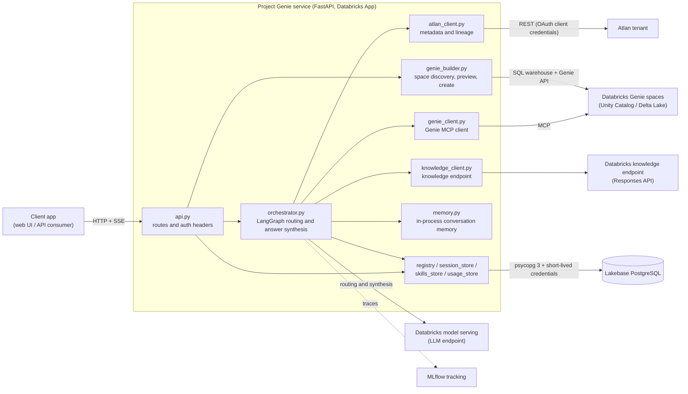

# databricks-atlan-genie-integration

Databricks + Atlan integration: enrich Genie with Atlan semantic metadata, lineage, and governance through MCP. Multi-agent AI with LangGraph on Delta Lake and Unity Catalog.

This repository contains the Python backend for **Project Genie**, a FastAPI service that routes questions to Databricks Genie spaces and can enrich answers with Atlan metadata and a Databricks knowledge endpoint.

## What it does

- Routes a user's question to one or more enabled Genie spaces and combines the answers.
- Streams progress and the final response over Server-Sent Events (SSE).
- Uses Atlan for AI application discovery, table context, data products, glossary terms, and lineage when configured.
- Supports creating Genie spaces from tables visible to the signed-in user.
- Persists the space registry, chat history and session context, skills, and usage history in Lakebase PostgreSQL.
- Exposes APIs for managing spaces, skills, sessions, and usage.

## Architecture

The service is a single FastAPI application. Each request runs on behalf of the signed-in user, and an orchestrator decides which Genie spaces and context sources to use.



### Request flow (`POST /api/chat` and `/api/chat/stream`)

1. **Authenticate.** `api.py` reads `X-Forwarded-Access-Token` and `X-Forwarded-Email`, so Databricks calls run as the signed-in user and sessions, skills, and usage are scoped per user.
2. **Load context.** The orchestrator loads the session's routing context from Lakebase and recent turns from in-process memory.
3. **Route.** The orchestrator reads the enabled spaces from the registry and, when `DATABRICKS_LLM_ENDPOINT` is set, uses the LLM to pick up to `MAX_ROUTED_SPACES` spaces for the question.
4. **Enrich (optional).** When Atlan is configured, `atlan_client.py` adds table context, data products, glossary terms, and lineage. When `DATABRICKS_KNOWLEDGE_ENDPOINT` is set, `knowledge_client.py` handles knowledge-style questions.
5. **Query Genie.** `genie_client.py` calls the selected spaces through the Genie MCP interface and collects the answers.
6. **Synthesize and stream.** The orchestrator combines the answers into one response. Progress and the final result are streamed as SSE events (or returned at once for `/api/chat`).
7. **Persist.** The chat messages, session context, and usage entry are written to Lakebase. If `MLFLOW_EXPERIMENT_ID` is set, LangChain calls are traced in MLflow.

### Genie space builder flow

`GET /api/spaces/builder/tables` lists tables visible to the user through the SQL warehouse. `POST /api/spaces/builder/preview` returns a proposed space and a signed confirmation token. `POST /api/spaces/builder/create` verifies the token, creates the Genie space, and registers it. The builder is enabled only when `GENIE_BUILDER_WAREHOUSE_ID` and `GENIE_BUILDER_SIGNING_SECRET` are both set.

### Atlan sync flow

`POST /api/spaces/sync-atlan` discovers AI applications in Atlan and registers or updates the matching Genie spaces in the registry. It requires `ATLAN_BASE_URL`, `ATLAN_CLIENT_ID`, and `ATLAN_CLIENT_SECRET`.

## Dependencies

### External services

| Service | Required | Used for | Configured by |
|---|---|---|---|
| Databricks workspace (Unity Catalog, Genie) | Yes | Genie spaces, user-authorized queries, SDK authentication | Databricks SDK environment |
| Lakebase PostgreSQL | Yes | Space registry, chat history, session context, skills, usage history | `PGHOST`, `PGDATABASE`, `PGUSER`, `DATABASE_ENDPOINT` |
| Databricks model serving (LLM endpoint) | No | LLM-assisted routing and answer orchestration | `DATABRICKS_LLM_ENDPOINT` |
| Databricks knowledge endpoint | No | Knowledge questions (Responses API) | `DATABRICKS_KNOWLEDGE_ENDPOINT` |
| Databricks SQL warehouse | No | Genie space builder (table discovery and creation) | `GENIE_BUILDER_WAREHOUSE_ID` |
| Atlan tenant | No | AI application discovery, table context, data products, glossary, lineage | `ATLAN_BASE_URL`, `ATLAN_CLIENT_ID`, `ATLAN_CLIENT_SECRET` |
| MLflow tracking | No | Experiment selection and LangChain autologging | `MLFLOW_TRACKING_URI`, `MLFLOW_EXPERIMENT_ID` |

### Python packages

Python 3.11 or later is required.

| Package | Purpose |
|---|---|
| `fastapi` | HTTP API and generated OpenAPI docs |
| `uvicorn` | ASGI server |
| `pydantic` | Request and response models, settings validation |
| `psycopg` (v3) | Lakebase PostgreSQL connections |
| `databricks-sdk` | Authentication, short-lived Lakebase credentials, workspace and Genie APIs |
| `databricks-mcp` | MCP client for Genie spaces |
| `langchain-core` | Message and runnable primitives |
| `langgraph` | Multi-step routing and orchestration graph |
| `requests` | Atlan and knowledge endpoint HTTP calls |
| `mlflow` | Tracing and experiment tracking |
| `databricks-langchain` | Databricks LLM integration (only when `DATABRICKS_LLM_ENDPOINT` is used) |

Install them with:

```bash
pip install -r requirements.txt
```

`requirements.txt` is the source of truth for versions. Pin them in your deployment process before running in production.

### Module map

| Module | Depends on |
|---|---|
| `api.py` | FastAPI, Pydantic, all stores, orchestrator, genie_builder |
| `orchestrator.py` | LangGraph, LangChain Core, databricks-langchain, genie_client, atlan_client, knowledge_client, memory, MLflow |
| `genie_client.py` | databricks-mcp, databricks-sdk |
| `genie_builder.py` | databricks-sdk (SQL warehouse and Genie APIs) |
| `atlan_client.py` | requests |
| `knowledge_client.py` | databricks-sdk, requests |
| `registry.py`, `session_store.py`, `skills_store.py`, `usage_store.py` | psycopg, databricks-sdk (credential generation) |
| `config.py`, `models.py` | Pydantic, environment variables |

## Project layout

```text
app.py                 Entry point for Databricks Apps
app.yaml               Databricks Apps configuration
requirements.txt       Python dependencies
backend_integration/
  api.py               FastAPI application factory and HTTP routes
  config.py            Environment-based settings
  orchestrator.py      Question routing and answer orchestration
  genie_client.py      Databricks Genie MCP client
  genie_builder.py     Genie space table discovery, preview, and creation
  atlan_client.py      Atlan metadata and lineage client
  knowledge_client.py  Databricks knowledge endpoint client
  registry.py          Lakebase-backed Genie space registry
  session_store.py     Persisted chat and routing context
  skills_store.py      User skill storage
  usage_store.py       Per-user usage history
  memory.py            In-process conversation memory
  models.py            API request and response models
```

## Requirements

- Python 3.11 or later.
- A Databricks workspace and an authenticated Databricks SDK environment.
- A Lakebase PostgreSQL database and a database endpoint configured for credential generation.
- At least one Genie space registered and enabled to answer Genie questions.
- The Python packages listed under [Dependencies](#dependencies).

## Configuration

The application reads configuration from environment variables. The four required variables are `PGHOST`, `PGDATABASE`, `PGUSER`, and `DATABASE_ENDPOINT`.

| Variable | Required | Default | Description |
|---|---:|---|---|
| `PGHOST` | Yes | — | Lakebase PostgreSQL host. |
| `PGDATABASE` | Yes | — | PostgreSQL database name. |
| `PGUSER` | Yes | — | PostgreSQL database user. |
| `DATABASE_ENDPOINT` | Yes | — | Lakebase endpoint identifier used by the Databricks SDK to generate short-lived database credentials. |
| `PGPORT` | No | `5432` | PostgreSQL port. |
| `PGSSLMODE` | No | `require` | PostgreSQL TLS mode. |
| `GENIE_REGISTRY_TABLE` | No | `public.registry_table` | Genie space registry table. |
| `GENIE_SESSION_CONTEXT_TABLE` | No | `public.session_context` | Persisted routing and conversation context table. |
| `GENIE_CHAT_SESSIONS_TABLE` | No | `public.chat_sessions` | Chat session table. |
| `GENIE_CHAT_MESSAGES_TABLE` | No | `public.chat_messages` | Chat message table. |
| `GENIE_SKILLS_TABLE` | No | `public.skills` | User skills table. |
| `GENIE_USAGE_HISTORY_TABLE` | No | `public.usage_history` | Usage history table. |
| `MAX_SESSIONS_PER_USER` | No | `5` | Maximum retained chat sessions per user. |
| `MAX_SKILLS_PER_USER` | No | `10` | Maximum skills per user. |
| `DATABRICKS_LLM_ENDPOINT` | No | Unset | Databricks model-serving endpoint used for LLM routing and answer orchestration. Without it, LLM-assisted routing is unavailable. |
| `DATABRICKS_KNOWLEDGE_ENDPOINT` | No | Unset | Optional Databricks Responses API endpoint for knowledge questions. |
| `GENIE_BUILDER_WAREHOUSE_ID` | No | Empty | SQL warehouse used by Genie space table discovery and creation. |
| `GENIE_BUILDER_PARENT_PATH` | No | Empty | Optional workspace parent path for created Genie spaces. |
| `GENIE_BUILDER_SIGNING_SECRET` | No | Empty | Secret used to sign Genie space preview confirmations. The builder is enabled only when this and the warehouse ID are set. |
| `GENIE_BUILDER_MAX_TABLES` | No | `500` | Maximum table results requested by the builder. |
| `GENIE_TIMEOUT_SECONDS` | No | `300` | Maximum time allowed for Genie requests. |
| `KNOWLEDGE_TIMEOUT_SECONDS` | No | `120` | Timeout for the knowledge endpoint request. |
| `MAX_ROUTED_SPACES` | No | `3` | Maximum number of Genie spaces selected for a question. |
| `ATLAN_BASE_URL` | No | Empty | Atlan tenant base URL. |
| `ATLAN_CLIENT_ID` | No | Empty | Atlan API client ID. |
| `ATLAN_CLIENT_SECRET` | No | Empty | Atlan API client secret. |
| `MLFLOW_TRACKING_URI` | No | Empty | MLflow tracking URI, for example `databricks`. |
| `MLFLOW_EXPERIMENT_ID` | No | Empty | When set, enables MLflow experiment selection and LangChain autologging. |
| `LLM_INPUT_PRICE_PER_MILLION` | No | `0` | Optional estimated input-token price in USD per million tokens. Zero disables cost estimates. |
| `LLM_OUTPUT_PRICE_PER_MILLION` | No | `0` | Optional estimated output-token price in USD per million tokens. Zero disables cost estimates. |

Store credentials in your deployment platform's secret manager. Do not commit credentials or local environment files.

### Lakebase tables

Before starting the service, provision the configured registry, session context, chat sessions, chat messages, skills, and usage history tables in the database. The store classes contain the table definitions in their `ensure_table()` methods, but the application does not run those methods automatically. Provision tables through an authorized migration or administrator; the application role may not have permission to create tables in the `public` schema. The startup sequence reads the registry table, so the registry must exist and be accessible.

The application uses Databricks-generated, short-lived PostgreSQL credentials for database connections. The Databricks identity running the service needs permission to generate credentials for the configured database endpoint and the database grants required to read/write the tables.

## Run locally

After installing the required dependencies and configuring Databricks authentication and the required environment variables, start the FastAPI app factory with Uvicorn:

```powershell
uvicorn backend_integration.api:create_app --factory --host 127.0.0.1 --port 8000
```

The service listens at `http://127.0.0.1:8000`. FastAPI's interactive API documentation is available at `/docs`, and its OpenAPI schema at `/openapi.json`.

## Deploy on Databricks Apps

The repository includes `app.py` and `app.yaml` for deployment as a Databricks App. Set the environment variables from the [Configuration](#configuration) section through the app's environment or secret resources, not in committed files.

Enable **User authorization**. The chat and Genie builder endpoints require the `X-Forwarded-Access-Token` header provided by the app platform so Databricks calls run on behalf of the signed-in user. User identity headers such as `X-Forwarded-Email` are used to scope user-specific sessions, skills, and usage.

## API overview

| Method | Path | Purpose |
|---|---|---|
| `GET` | `/api/health` | Basic service health and LLM configuration status. |
| `GET` | `/api/me` | Returns the forwarded user identity, if present. |
| `GET` | `/api/spaces` | List registered Genie spaces. |
| `PATCH` | `/api/spaces/{space_id}` | Update a space. |
| `DELETE` | `/api/spaces/{space_id}` | Delete a space from the registry. |
| `POST` | `/api/spaces/sync-atlan` | Discover and sync Atlan AI applications. Requires Atlan configuration. |
| `GET` | `/api/spaces/builder/tables` | Discover tables visible to the signed-in user. |
| `POST` | `/api/spaces/builder/preview` | Preview a proposed Genie space and receive a confirmation token. |
| `POST` | `/api/spaces/builder/create` | Create the confirmed Genie space and register it. |
| `POST` | `/api/chat` | Ask a question and receive a complete response. |
| `POST` | `/api/chat/stream` | Ask a question and receive progress/final events as SSE. |
| `GET` | `/api/sessions` | List the caller's chat sessions. |
| `GET` | `/api/sessions/{session_id}/messages` | Get messages for a chat session. |
| `DELETE` | `/api/sessions/{session_id}` | Clear in-process memory for a session. |
| `GET` | `/api/usage` | Get the caller's usage summary and recent entries. |
| `GET` | `/api/usage/export` | Get the caller's full retained usage history. |
| `GET` | `/api/skills` | List the caller's skills. |
| `POST` | `/api/skills` | Create a skill. |
| `PATCH` | `/api/skills/{skill_id}` | Update a skill. |
| `DELETE` | `/api/skills/{skill_id}` | Delete a skill. |

The chat request body uses `session_id` and `message`. See the generated `/docs` page for the complete request and response schemas.
